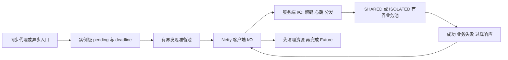

# 线程、生命周期与关闭设计

## 来源与新增内容

底座固定 e2f0dd1；原框架的通信协议、Netty、Hessian/GZIP、SPI、Spring、代理、ZooKeeper 注册发现均保留。2026 两个上游提交仅供设计参考，未整体 cherry-pick。请求可靠性回补、服务级执行器、故障测试与评测模块是本分支的实现。执行器隔离思路参考 Dubbo；JMH 模块组织参考 apache/dubbo-benchmark@0641cb0，未复制其源码。

## 线程模型

Netty boss=1、worker=2；客户端每个独立连接实例有 2 个 I/O 线程。Handler 在 I/O 线程解码、处理心跳和提交任务，不执行用户业务。业务在 ServiceExecutorManager 创建的固定 ThreadPoolExecutor 中执行。SHARED/ISOLATED 共享同一 Handler 分发逻辑；唯一改变是池资源映射。

每个客户端有有界的 2 线程/256 队列准备池，用于服务发现；超时从调用入口开始，涵盖发现和连接。建连采用异步 ChannelFuture，不阻塞 I/O 线程。连接缓存由每个客户端独立拥有，通过 closeFuture 清除失效条目；多个客户端能真实建立多个连接。

ServiceKey 使用接口、group、version 三字段相等判断。启动时冻结服务表，RpcExecutorConfig.withService 支持静态覆盖。ZooKeeper 的旧路径格式没有变化；其字符串拼接歧义和持久节点宕机残留仍是已知边界，不能宣称自动摘除。

## 请求终结

每个实例独立维护 pending Map。注册、附属资源挂接、按 Future 身份移除在锁内；先移除 Map 和取消计时/准备任务，再完成 Future，用户回调在锁外运行。资源在挂接前已终结时立即取消挂接对象，不能复活请求。成功、业务失败、过载、发送失败、断连、超时、取消和客户端 close 都使用同一终结入口。响应必须匹配 requestId 和 Channel，迟到/未知响应仅计数。

NettyRpcClient.sendRpcRequestAsync 返回真正的异步请求结果；同步 sendRpcRequest 与 RpcClientProxy 保持原体验，RpcCallException.Kind 区分 TIMEOUT、OVERLOADED、TRANSPORT、BUSINESS、CLOSED。取消沿用 CompletableFuture CancellationException。普通业务异常返回 501，过载 503，服务关闭 504，均携带原 requestId；null 是正常成功值。没有自动重试。

取消是本地语义，不能撤回已提交的网络写或停止远程业务；没有服务端取消协议、端到端 deadline 或 CompletionStage 服务端支持。Future 回调应保持非阻塞；close 应从管理线程调用，不在 Netty EventLoop 回调中阻塞等待关闭。发现函数需响应中断或有自己的等待上限；任意永不返回的自定义发现实现无法被 Java 安全强制终止，close 会报告失败。

## 有界资源与关闭

ArrayBlockingQueue + AbortPolicy；不得 CallerRuns 退回 I/O 线程。拒绝回复 503，不把拒绝计为成功吞吐。队列容量不是远程异步任务的并发控制。服务固定，不做动态增删或热调参。

关闭先停止业务提交，再关闭监听 Channel，然后在统一时限内等待业务，超时中断运行任务并对尚未执行的队列任务回复关闭错误，最后关闭 I/O 资源。忽略中断的业务任务会使关闭失败，不能声称无条件安全关闭。服务器每实例只注册一个 Hook，显式关闭会移除；旧 Socket Hook 也防重复注册。客户端 close 清理本实例所有请求、计时器、准备池和 I/O 组。Socket 示例保持编译，不包含新增异步能力。

## 公平评测

基准服务器、客户端分 JVM；固定同一构建，Hessian+GZIP，WARN 日志，每 JVM ActiveProcessorCount=4、256 MiB 堆。SHARED 为 16 线程/队列 200；ISOLATED 快慢各 8/100。相同线程总量与队列总容量并不保证共享模式下各服务有相同的可用容量，静态划分存在闲置代价。

稳态评测显式配置服务地址，排除 ZooKeeper 查找耗时；ZooKeeper 注册发现另外通过原示例验证。JMH 每 invocation 对应一次内容核对成功的 RPC；异常使运行失败。脚本每个外层 fork 重启服务端，JMH 本身每次 -f 1，manifest 记录完整命令。

ScenarioRunner 为快慢请求独立规划到达时间，限制总在途量，结果写入独立有界队列；记录未发出、分类错误、调度延迟、实际发送和完成时间。停止发流量后限时结算全部请求并检查 pending/timer/项目线程。阶段成功率按计划所属 cohort 跟踪到终结；QPS 按完成时间窗口计算，两者口径不同。成功、失败延迟分开；每次先从原始样本计算 nearest-rank P95/P99，跨次报告中位数/范围，不平均每秒分位数。

预定义生成器有效性：无未发出/内容错误/丢失结果，非预热阶段调度 P99 <=20ms；无效运行保留原始数据但不参与 A/B 性能结论。恢复定义：过载输入停止后连续三个 1 秒 cohort 成功率 >=99%、成功 P95 <=100ms。队列指标每秒采样，峰值可能漏瞬态；确定性测试直接检查容量边界。

## 故障证据范围

RequestLifecycleTest、ServerResponseTest、ServiceIsolationTest 覆盖连接拒绝（非网络黑洞）、写失败、发现超时、取消、断连 A/B、迟到响应、null/业务异常、双客户端、相同接口 group/version、队列过载、强制关闭及 1000 次响应/超时/取消竞态。scripts/fault-report.py 重复运行并保留当次 XML、命令状态、实际结果分布。pending=0 不等于堆内存没有任何泄漏。

注册中心首次连接现在由同步初始化保护，连接成功前不进入共享缓存；被中断或超时就关闭候选连接并传播错误。适配器派生 Future 的取消显式向底层传播。最终构建与较早评测数据不混合统计，详情见 MEASUREMENTS.md。
